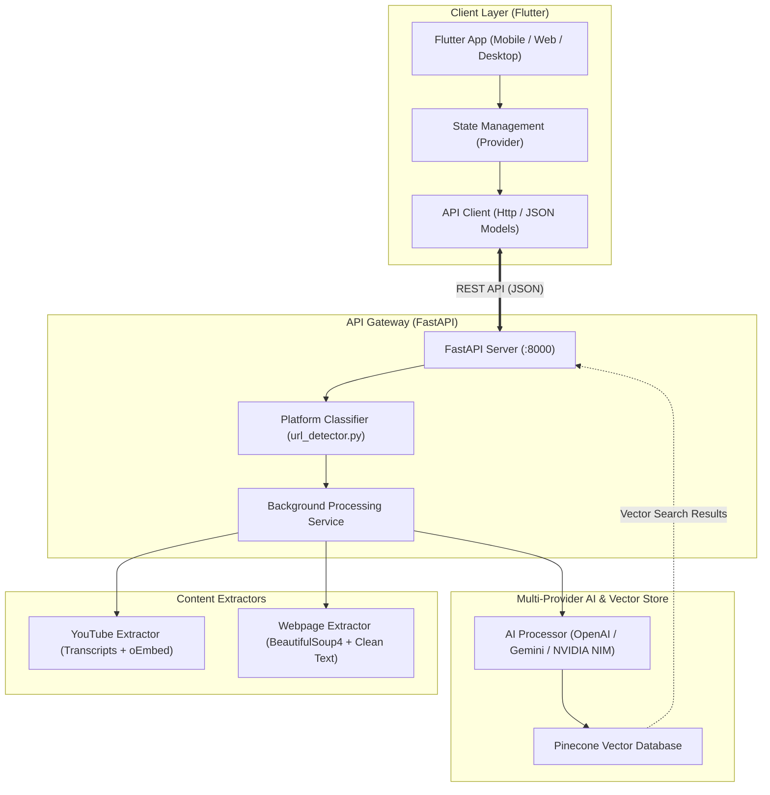

# Recall (Bookmark AI)

```
  ____  _____ ____    _    _     _     
 |  _ \| ____/ ___|  / \  | |   | |    
 | |_) |  _|| |     / _ \ | |   | |    
 |  _ <| |__| |___ / ___ \| |___| |___ 
 |_| \_\_____\____/_/   \_\_____|_____|
```

<div align="center">

[](https://flutter.dev)
[](https://dart.dev)
[](https://fastapi.tiangolo.com)
[](https://www.python.org)
[](https://ai.google.dev)
[](https://build.nvidia.com)
[](https://openai.com)
[](https://www.pinecone.io)
[](LICENSE)

**AI-powered universal bookmark aggregator and personal knowledge base with hybrid semantic search and conversational synthesis.**

[Features](#features) •
[Architecture](#system-architecture) •
[Multi-Provider AI](#multi-provider-ai-support) •
[Quickstart](#getting-started) •
[API Reference](#api-reference) •
[Testing](#testing--quality-assurance) •
[Roadmap](#roadmap--hardening)

</div>

---

## Overview

Users collect dozens of links, articles, YouTube videos, and social posts across multiple applications every week, yet frequently fail to locate them later because standard bookmark managers only perform literal substring matches on page titles or URLs.

Recall converts static URLs into an active, searchable knowledge base:
1. **Ingestion:** Ingest web or video URLs across major content platforms.
2. **Deep Extraction:** Extract full transcripts from YouTube videos or clean, readable article bodies from websites without advertising scripts or navigation boilerplate.
3. **AI Distillation:** Automatically produce 2 to 3 sentence executive summaries, key takeaway bullet points, and categorized topic tags via your chosen provider (**Google Gemini**, **NVIDIA NIM**, or **OpenAI**).
4. **Semantic Retrieval:** Generate vector embeddings stored in a Pinecone vector index. Search using natural language queries (*"What was that video explaining transformer attention?"*) to obtain ranked bookmarks by relevance score alongside a synthesized answer compiled from saved materials.

---

## Features

* **Universal Ingestion** — Save content from YouTube, Twitter/X, Instagram, Spotify, GitHub, Reddit, Medium, Substack, and generic websites.
* **YouTube Transcript Parsing** — Extracts captions, video metadata, and creator details via `youtube-transcript-api` without requiring YouTube Data API keys.
* **Multi-Provider AI Architecture** — Native support for **Google Gemini**, **NVIDIA NIM**, and **OpenAI**. Decouple reasoning from embedding generation to avoid vendor lock-in.
* **Resilient Output Parsing** — Robust JSON extractor handling direct JSON, markdown codeblocks (````json ... ````), and conversational wrappers across open-source and proprietary models.
* **Semantic Search & Synthesis** — Natural language search queries return ranked bookmark cards accompanied by an LLM-synthesized answer.
* **Flutter Cross-Platform Client** — OLED dark interface (`#0F0F14`), responsive layouts, modal detail sheets, tactile physics, clipboard paste integration, and background polling.
* **Dynamic Server Switcher** — Built-in server configuration dialog with a live ping diagnostic to switch between Localhost, Android Emulator (`10.0.2.2:8000`), or remote hosts with one click.

---

## Multi-Provider AI Support

Recall eliminates model vendor lock-in by implementing OpenAI-compatible abstraction layers across three major AI providers:

| Provider | Supported Models (Default) | Embedding Model | Vector Dimension | Base URL |
|---|---|---|---|---|
| **Google Gemini** | `gemini-1.5-flash`, `gemini-1.5-pro` | `text-embedding-004` | 768 | `https://generativelanguage.googleapis.com/v1beta/openai/` |
| **NVIDIA NIM** | `meta/llama-3.3-70b-instruct`, `mistralai/mistral-large-2` | `nvidia/llama-3.2-nv-embedqa-1b-v2` | 2048 | `https://integrate.api.nvidia.com/v1` |
| **OpenAI** | `gpt-4o-mini`, `gpt-4o` | `text-embedding-3-small` | 1536 | Default (`https://api.openai.com/v1`) |

### Decoupled Reasoning and Embeddings

Pinecone vector indexes have fixed vector dimensions defined at creation time. Recall decouples `LLM_PROVIDER` and `EMBEDDING_PROVIDER`:
* You can run `gemini-1.5-flash` or NVIDIA Llama 3.3 for high-speed, cost-effective summarization while preserving your existing 1536-dimension OpenAI vector store.
* Or run pure Gemini (768-dim Pinecone index) or pure NVIDIA NIM (2048-dim Pinecone index).
* Set `LLM_PROVIDER=auto` and `EMBEDDING_PROVIDER=auto` for automatic credential-based detection.

---

## System Architecture



---

## Tech Stack

| Layer | Technologies |
|---|---|
| **Mobile / Frontend** | Flutter 3.47+, Dart 3.13+, Provider, Material 3 Dark Theme |
| **Backend API** | FastAPI 0.109+, Uvicorn (ASGI), Pydantic v2, Pydantic-Settings |
| **Content Scraping** | BeautifulSoup4, HTTPX (Async), YouTube Transcript API |
| **AI Providers** | Google Gemini, NVIDIA NIM, OpenAI API |
| **Vector Storage** | Pinecone Vector Database (Cosine Metric) |
| **Networking** | RESTful HTTP/JSON with CORS and structured error handling |

---

## Monorepo Structure

```
Recall/
|-- backend/                       # FastAPI Backend
|   |-- app/
|   |   |-- main.py                # Application entrypoint & CORS middleware
|   |   |-- config.py              # Pydantic v2 environment settings & multi-provider resolution
|   |   |-- routes/
|   |   |   |-- bookmarks.py       # CRUD operations & background worker triggers
|   |   |   `-- search.py          # Semantic search & LLM answer synthesis
|   |   `-- services/
|   |       |-- processor.py       # Extraction & AI orchestration pipeline
|   |       |-- url_detector.py    # URL platform detection & classification
|   |       |-- ai_processor.py    # Multi-provider summarizer, embedding generator & robust JSON parser
|   |       |-- vector_search.py   # Pinecone indexing and semantic search
|   |       `-- extractors/
|   |           |-- youtube.py     # YouTube transcript & metadata scraper
|   |           `-- webpage.py     # Generic article & web content cleaner
|   |-- tests/                     # Backend automated test suite (pytest)
|   |-- requirements.txt           # Python dependencies
|   |-- .env.example               # Environment variables template
|   `-- venv/                      # Python virtual environment (gitignored)
|
|-- mobile/                        # Cross-Platform Flutter Mobile/Web App
|   |-- lib/
|   |   |-- main.dart              # MultiProvider setup & root widget
|   |   |-- core/
|   |   |   |-- constants/         # API endpoints & OLED color palette
|   |   |   |-- network/           # ApiClient & typed ApiException classes
|   |   |   |-- services/          # SharedPreferences persistence
|   |   |   |-- theme/             # Material 3 dark theme specifications
|   |   |   `-- widgets/           # Tactile physics, glassmorphic containers & animations
|   |   |-- models/                # Bookmark, SearchResult, SearchResponse models
|   |   |-- providers/             # BookmarksProvider, SearchProvider, SettingsProvider
|   |   `-- screens/
|   |       |-- main_navigation_screen.dart # Floating navigation bar
|   |       |-- home/              # Bookmarks list, filter chips & modal details
|   |       |-- search/            # Query bar, suggestions, AI answer card
|   |       |-- add/               # URL validation & clipboard paste
|   |       `-- settings/          # Server configuration dialog & live ping
|   |-- test/                      # Unit & widget test suites (100% passing)
|   `-- pubspec.yaml               # Flutter package configuration
|
|-- mobile_rn/                     # Archived React Native / Expo implementation
`-- README.md
```

---

## Getting Started

### Prerequisites

* Python: 3.11 or higher
* Flutter SDK: 3.24 or higher (Dart 3.5+)
* Vector Database:
  * [Pinecone API Key & Index](https://www.pinecone.io/) (Dimension matched to embedding provider, Metric: cosine)
* AI Provider Key (At least one):
  * [Google AI Studio API Key](https://aistudio.google.com/)
  * [NVIDIA API Catalog Key](https://build.nvidia.com/)
  * [OpenAI API Key](https://platform.openai.com/api-keys)

---

### 1. Backend Setup

```powershell
# Navigate to backend
cd backend

# Create and activate virtual environment
python -m venv venv
.\venv\Scripts\activate          # Windows PowerShell
# source venv/bin/activate       # macOS / Linux

# Install dependencies
pip install -r requirements.txt

# Configure environment
copy .env.example .env           # Windows
# cp .env.example .env           # macOS / Linux
```

Update `.env` with your desired provider credentials:

```ini
# Provider Selection (auto, openai, gemini, or nvidia_nim)
LLM_PROVIDER=gemini
EMBEDDING_PROVIDER=openai

# Google Gemini (OpenAI-compatible)
GEMINI_API_KEY=your-gemini-key
GEMINI_MODEL=gemini-1.5-flash

# NVIDIA NIM (OpenAI-compatible)
NVIDIA_NIM_API_KEY=your-nvidia-key
NVIDIA_NIM_MODEL=meta/llama-3.3-70b-instruct

# OpenAI
OPENAI_API_KEY=your-openai-key
OPENAI_MODEL=gpt-4o-mini
OPENAI_EMBEDDING_MODEL=text-embedding-3-small

# Vector Database
PINECONE_API_KEY=your-pinecone-key
PINECONE_INDEX=bookmarks
PINECONE_ENVIRONMENT=us-east-1

DEBUG=true
```

Start the backend server:
```powershell
uvicorn app.main:app --reload --port 8000
```
Verify the server is running by opening `http://127.0.0.1:8000/health`.

---

### 2. Mobile App Setup (Flutter)

Open a second terminal:

```powershell
cd mobile

# Fetch Flutter dependencies
flutter pub get

# Verify environment & dependencies
flutter analyze
flutter test
```

#### Running the Application:

* In Browser (Brave / Chrome / Edge):
  ```powershell
  flutter run -d chrome
  ```
  *(To direct execution to Brave on Windows, ensure the `CHROME_EXECUTABLE` environment variable references `brave.exe`)*

* On Android Emulator or Physical Device:
  ```powershell
  flutter run
  ```

* Connecting to the Backend:
  Access the Server Settings dialog from the top-right toolbar button in the application to configure the API URL:
  * Browser / Desktop: `http://127.0.0.1:8000`
  * Android Emulator: `http://10.0.2.2:8000`
  * Physical Device: `http://<YOUR_LOCAL_IP>:8000`

---

## API Reference

Interactive OpenAPI documentation is hosted at `http://127.0.0.1:8000/docs`.

### Endpoints Overview

| Method | Endpoint | Description |
|---|---|---|
| `GET` | `/health` | Health check endpoint returning server status and active AI providers. |
| `POST` | `/api/bookmarks` | Ingest a new URL. Launches background extraction & AI tagging. |
| `GET` | `/api/bookmarks` | List bookmarks with pagination and status/platform filters. |
| `GET` | `/api/bookmarks/{id}` | Retrieve full details of a specific bookmark. |
| `DELETE` | `/api/bookmarks/{id}` | Delete a bookmark by ID. |
| `GET` | `/api/search` | Natural language query search across vector embeddings. |

---

### Sample Requests & Responses

#### Ingest a Bookmark
```http
POST /api/bookmarks
Content-Type: application/json

{
  "url": "https://www.youtube.com/watch?v=dQw4w9WgXcQ",
  "notes": "Sample video ingestion test"
}
```

```json
{
  "id": "3fa85f64-5717-4562-b3fc-2c963f66afa6",
  "url": "https://www.youtube.com/watch?v=dQw4w9WgXcQ",
  "platform": "youtube",
  "title": null,
  "summary": null,
  "key_points": null,
  "tags": null,
  "status": "pending",
  "created_at": "2026-10-30T10:00:00Z",
  "processed_at": null
}
```

#### Semantic Search
```http
GET /api/search?q=machine+learning+attention&limit=5
```

```json
{
  "query": "machine learning attention",
  "total": 1,
  "answer": "The Attention Is All You Need paper introduces the Transformer model, relying solely on self-attention mechanisms to compute representations without recurrent layers.",
  "results": [
    {
      "bookmark_id": "3fa85f64-5717-4562-b3fc-2c963f66afa6",
      "url": "https://arxiv.org/abs/1706.03762",
      "title": "Attention Is All You Need",
      "summary": "Foundational paper detailing the Transformer neural network architecture.",
      "relevance_score": 0.942,
      "matched_content": null
    }
  ]
}
```

---

## Testing & Quality Assurance

The codebase incorporates automated test verification and static analysis across backend and mobile layers:

### Backend Test Suite (Pytest)
Execute backend unit tests covering provider auto-detection, client routing, mock LLM generation, and resilient JSON parsing:
```powershell
backend\venv\Scripts\python.exe -m pytest backend/tests -v
```

### Flutter Automated Test Suite
Execute the test runner and linter from the `mobile/` directory:
```powershell
cd mobile
flutter analyze
flutter test
```

Test coverage includes:
* Model serialization and null-safety handling ([`bookmark_test.dart`](file:///d:/Projects/Recall/mobile/test/models/bookmark_test.dart))
* Match score percentage calculation and search response parsing ([`search_test.dart`](file:///d:/Projects/Recall/mobile/test/models/search_test.dart))
* Bookmarks state management, platform filtering, and insertion ([`bookmarks_provider_test.dart`](file:///d:/Projects/Recall/mobile/test/providers/bookmarks_provider_test.dart))
* Search state lifecycle and query clearing ([`search_provider_test.dart`](file:///d:/Projects/Recall/mobile/test/providers/search_provider_test.dart))
* Full widget navigation, tab indexing, and form validation ([`widget_test.dart`](file:///d:/Projects/Recall/mobile/test/widget_test.dart))

---

## Roadmap & Hardening

* [x] Monorepo architecture and FastAPI backend foundation
* [x] YouTube transcript extraction via oEmbed and caption scraping
* [x] Generic webpage article extraction with BeautifulSoup4
* [x] Multi-provider AI summarization (Google Gemini, NVIDIA NIM, OpenAI)
* [x] Resilient markdown fence and unstructured JSON parsing fallback
* [x] Semantic search with natural language AI answer generation
* [x] Flutter cross-platform mobile and web client implementation
* [x] Dynamic server configuration and live health monitoring
* [ ] **Database Persistence:** Migrate from in-memory dictionary to Supabase / PostgreSQL.
* [ ] **Authentication & Multi-Tenancy:** Secure endpoints with Bearer JWTs and user-scoped Pinecone namespaces.
* [ ] **Rate Limiting & Abuse Prevention:** Add `slowapi` rate-limiting to protect API token quotas.
* [ ] **SSRF Guard:** Validate target hostnames to prevent access to local loopbacks and cloud metadata endpoints.
* [ ] **Native Mobile Share Intent:** Enable one-tap "Share to Recall" directly from external Android and iOS apps.

---

## License

This project is licensed under the [MIT License](LICENSE).
